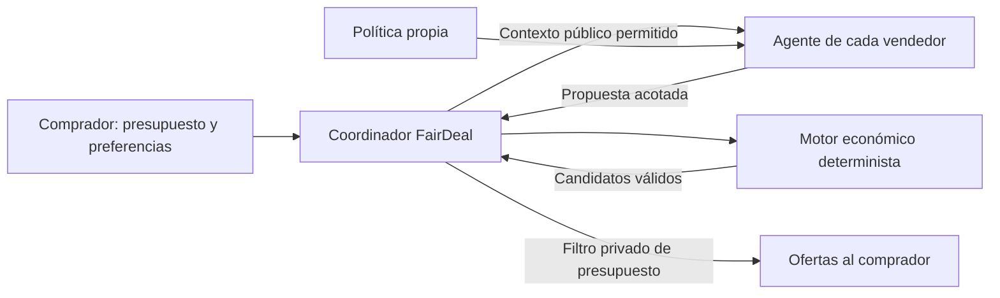
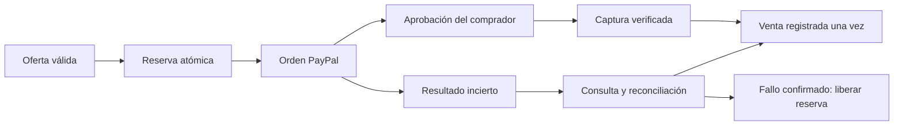

<p align="center"></p>

# FairDeal

**Acuerdos que aprovechan la flexibilidad del comprador y del comercio, sin revelar al vendedor el presupuesto máximo del comprador.**

FairDeal compara propuestas de cinco comercios ficticios. Cada comercio combina precio, un accesorio, plazo de entrega y preferencias de pago dentro de sus límites de rentabilidad. La IA interpreta preferencias y propone ajustes; un motor determinista en Go autoriza los acuerdos económicamente válidos. El comprador elige y puede completar el checkout con PayPal Sandbox.

Proyecto para la PayPal AI Hackathon. **Es un prototipo: catálogo, comercios, costes y entregas son escenarios de demostración.** `mock` simula pagos; `sandbox` usa el entorno de pruebas de PayPal. Ninguno transfiere fondos reales ni despacha productos.

- [Aplicación](https://fairdeal-5h0w.onrender.com/) · [Login del vendedor](https://fairdeal-5h0w.onrender.com/merchant/login).
- [Repositorio compartido](https://github.com/MauricioSo/fairdeal) · [Licencia MIT](LICENSE).

## Contenido

- [Idea y alcance](#idea-y-alcance)
- [Comercios de demostración](#comercios-de-demostración)
- [Flujos de comprador y vendedor](#flujos-de-comprador-y-vendedor)
- [Negociación y privacidad](#negociación-y-privacidad)
- [Motor económico](#motor-económico)
- [Contratos, inventario y pagos](#contratos-inventario-y-pagos)
- [Arquitectura](#arquitectura)
- [Instalación local](#instalación-local)
- [Configuración](#configuración)
- [Extensión de Chrome](#extensión-de-chrome)
- [API y vistas](#api-y-vistas)
- [Persistencia y seguridad](#persistencia-y-seguridad)
- [Despliegue y validación](#despliegue-y-validación)
- [Branding](#branding)
- [Limitaciones y próximos pasos](#limitaciones-y-próximos-pasos)
- [Colaboración](#colaboración)

## Idea y alcance

Una venta puede ser inviable con un checkout rígido y viable al cambiar otras condiciones. Un comprador puede esperar más días, aceptar un accesorio útil o explorar Pay Later. Un vendedor puede aprovechar capacidad de envío contratada, rotar inventario estancado o proponer un pack cuyo valor para el comprador supere su coste incremental.

FairDeal busca esa compatibilidad. No se limita a pedir una rebaja ni permite que un agente invente descuentos ilimitados.

| Flexibilidad | Beneficio posible | Restricción |
| --- | --- | --- |
| Precio | Ajustar el total | Descuento, contribución y márgenes autorizados |
| Pack | Agregar un accesorio útil | Coste conocido, stock y protecciones por producto |
| Entrega | Express o terrestre consolidada | Preferencias, política y coste de cada opción |
| Pago | Explorar PayPal Pay Later | Elegibilidad y condiciones del proveedor |
| Inventario | Favorecer rotación de accesorios excedentes | La utilidad por rotación no se contabiliza como ingreso |

Por ejemplo, un comercio puede preferir incluir una bufanda de bajo coste incremental y usar entrega consolidada antes que rebajar agresivamente la parka. Otro puede tener capacidad express más barata. Ambas propuestas deben pasar las mismas comprobaciones económicas; el ejemplo no garantiza una oferta para cualquier presupuesto.

**Implementado:** cinco escenarios persistentes, login por comercio, edición de catálogo y políticas, simulador económico, comparación de acuerdos, reservas de inventario, checkout mock/Sandbox, reconciliación y extensión MV3.

**Fuera del alcance actual:** comercios reales conectados, búsqueda universal de equivalencias, carritos arbitrarios, logística física, fiscalidad por jurisdicción y liquidación a vendedores reales.

## Comercios de demostración

El producto principal de comparación es la parka `CH-WINTER-PARKA-01`. El pack admite una unidad principal y una del accesorio configurado. Estos valores iniciales están en USD; las ediciones y ventas persistidas pueden cambiarlos.

| Comercio / ID | Precio / coste parka | Stock inicial | Accesorio | Coste / valor de referencia | Stock accesorio | Incentivo |
| --- | --- | --- | --- | --- | --- | --- |
| Alpine Gear Co. / `alpine` | 120 / 50 | 40 | Cashmere Scarf | 9 / 25 | 500 | Rotar excedentes |
| Nordic Peak Outfitters / `nordic` | 125 / 58 | 30 | Thermal Pack | 6 / 20 | 80 | Capacidad express |
| Glacier Basecamp Direct / `glacier` | 110 / 52 | 60 | Sin accesorio | — | 0 | Precio bajo |
| Sierra Eco-Apparel / `sierra` | 130 / 65 | 25 | Winter Beanie | 10 / 28 | 70 | Entrega consolidada y rotación |
| Polaris Urban Techwear / `polaris` | 150 / 72 | 35 | Winter Gloves | 8 / 24 | 90 | Flexibilidad de pago |

| Comercio | Coste express / terrestre | Margen mínimo inicial | Descuento máximo inicial | Destinos demo |
| --- | --- | --- | --- | --- |
| Alpine | 15 / 4 | 20% | 30% | US, CL |
| Nordic | 3 / 5 | 22% | 25% | US, CL |
| Glacier | 10 / 4 | 20% | 30% | US |
| Sierra | 12 / 5 | 25% | 20% | US, CL |
| Polaris | 15 / 5 | 22% | 30% | US |

Plazos de referencia: express de 1–2 días y terrestre de 5–7 días. No son cotizaciones ni compromisos de un transportista. Cada comercio mantiene base SQLite, stock, política, sesiones e historial propios. Los escenarios se inicializan sin reiniciar el stock vendido en cada arranque.

## Flujos de comprador y vendedor

### Comprador

1. Abre la aplicación o importa una referencia desde la extensión.
2. Define presupuesto máximo privado en USD, destino, flexibilidad de entrega, aceptación de accesorio y preferencia de Pay Later. También puede expresar su intención en lenguaje natural.
3. El coordinador consulta los escenarios compatibles y construye propuestas dentro de sus políticas.
4. El motor económico rechaza combinaciones inválidas y el coordinador filtra las que exceden el presupuesto.
5. Compara total, comercio, accesorio y entrega. **Las ofertas se ordenan por precio total**, no por una valoración universal del mejor pack.
6. Selecciona un acuerdo; el servidor valida vigencia y economía y reserva inventario para crear la orden.
7. Aprueba el checkout y obtiene un comprobante tras la captura verificada. En mock todo el pago es simulado.

El precio de una tienda externa no se convierte automáticamente en presupuesto. Importar un producto tampoco inicia un pago. Pay Later es una preferencia sujeta a elegibilidad del proveedor.

Los ahorros comparan contra el checkout estándar del catálogo demo del propio comercio. **No son precios de mercado verificados ni ahorros acreditados frente a la tienda externa.**

### Vendedor

El acceso comienza en `/merchant/login`, sin introducir manualmente un token en un botón de la consola.

- **Copilot de estrategia:** interpreta una instrucción comercial y compila un borrador. El vendedor revisa resultado y ajustes antes de activarlo explícitamente.
- **Rendimiento:** métricas de acuerdos y capturas. El baseline y el incremento de conversión no se presentan como medidos sin evidencia.
- **Inventario y packs:** precios, costes, existencias y condición de accesorio. Archivar conserva historial y deja stock disponible en cero.
- **Protecciones financieras:** edición manual de reglas, mínimos, costes y comisiones, con simulación antes de activar.
- **Auditoría:** eventos y desglose económico privado por acuerdo.

El copilot actual es un compilador de políticas con interfaz de chat. **No gestiona autónomamente el inventario ni ejecuta acciones comerciales libres.** La compilación conserva las protecciones económicas; el servidor valida los límites.

El simulador no reserva stock, crea pagos ni predice aceptación. El margen unitario `(precio − coste) / precio` del catálogo es diferente del margen de contribución final, que descuenta todos los costes del acuerdo.

## Negociación y privacidad



FairDeal central conoce el máximo para validar viabilidad. Los vendedores y sus agentes no lo reciben. Cada agente recibe una proyección explícita: producto público, preferencias permitidas, política propia, ronda y propuesta previa. Se excluyen presupuesto, utilidad privada, texto original del comprador y datos de competidores.

Los agentes proponen ajustes acotados, como accesorio o Pay Later; no tienen autoridad sobre el precio final. Hay hasta dos revisiones de concesión, con concurrencia y tiempos limitados y fallback determinista identificado.

La búsqueda usa techos públicos derivados del catálogo y la política. El presupuesto privado filtra en el coordinador; no se entrega como ancla de precio al vendedor. El escenario usa una valoración de referencia fija de USD 135, distinta del presupuesto máximo.

Dentro de cada comercio, el solver compara combinaciones con un objetivo de Nash ponderado sobre excedentes positivos:

```text
alpha × log(excedente del comprador)
    + (1 − alpha) × log(excedente del vendedor)
```

La política limita el peso y las combinaciones. El redondeo se vuelve a validar; si rompe una protección, se conserva un candidato válido en centavos. Ordenar después por precio entre comercios no es una optimización global de Nash de todos los participantes.

Los acuerdos nuevos, métricas y APIs del vendedor no persisten ni exponen presupuesto o excedente privado. Los campos heredados se limpian en migración y quedan fuera de las respuestas. Sin embargo, una intención escrita puede contener presupuesto y enviarse al proveedor de IA del comprador. La separación protege frente al vendedor: **no implica procesamiento exclusivamente local ni privacidad absoluta frente a inferencias**. Aceptar un precio revela ese importe.

## Motor económico

`internal/economics` es puro: sin base de datos, HTTP ni modelo. Autoriza rentabilidad usando **centavos enteros y puntos básicos**; 100 puntos básicos equivalen a 1%.

```text
neto = floor(total × 10000 / (10000 + impuesto_incluido_bps))
impuesto = total − neto

contribución = neto
             − coste de artículos y accesorio
             − envío asumido por el comercio
             − preparación y embalaje
             − comisión de pago
             − comisión de plataforma

margen de contribución = contribución / neto
```

El total es el importe completo cobrado. La comisión porcentual de pago se aplica al total; la de plataforma, al neto. Se calculan redondeos deterministas y comisiones fijas. El impuesto incluido no sustituye un motor fiscal por jurisdicción.

**Ejemplo ilustrativo:** cobrar USD 100 sin impuesto, con costes de 50 de producto, 9 de accesorio, 4 de envío, 2 de preparación/embalaje y 4 de comisiones deja 31 de contribución y 31% de margen. Debe superar tanto el mínimo porcentual como el absoluto configurados. No es una cotización del sistema.

Cada candidato debe cumplir:

- Coste de producto conocido y válido; un coste ausente o cero bloquea ofertas automáticas.
- Stock suficiente de artículo principal y accesorio.
- Descuento máximo, margen mínimo de orden y contribución mínima absoluta.
- Protecciones y márgenes por producto cuando estén configurados.
- Opciones de entrega y pago autorizadas.

Para márgenes por producto se distribuye ingreso según valores de lista y se asignan costes conservadoramente. La protección usa las comprobaciones implementadas sobre esos valores y el total del pack; no es contabilidad de carritos arbitrarios. Liberar inventario puede mejorar la utilidad para ordenar candidatos, pero **no aumenta ingresos contables para aprobar un margen**.

La configuración incluye `min_contribution_cents`, `handling_cents`, `packaging_cents`, `platform_fee_bps`, `platform_fixed_cents`, `included_tax_bps`, costes de entrega, comisiones de pago y reglas por SKU. Los rechazos diferencian margen o contribución insuficiente, producto protegido, descuento excesivo y costes faltantes.

Los resultados dependen de los datos declarados. Los gastos opcionales heredados pueden ser cero y deben revisarse antes de uso real. No se consultan automáticamente tarifas efectivas de PayPal, transportistas o impuestos.

## Contratos, inventario y pagos

Un contrato HMAC vincula comercio, producto, política, importe, moneda, entrega, preferencia de pago, accesorio y vencimiento. Cada nuevo acuerdo guarda una instantánea económica privada y una revisión de las entradas económicas.

Antes de reservar se comprueban firma, vigencia, vínculos y revisión, y se reevalúa la economía dentro de la transacción de inventario. El navegador no determina el importe de la orden PayPal. Activar políticas o editar catálogo invalida cotizaciones pendientes afectadas; las reservas activas bloquean cambios incompatibles. Las órdenes reservadas conservan sus condiciones congeladas.



La reserva descuenta existencias atómicamente para evitar ventas simultáneas del mismo stock. La captura consume la reserva una sola vez. Un fallo confirmado o un abandono que pueda expirar con seguridad la libera una sola vez. **Un timeout no demuestra un fallo de pago:** una operación incierta conserva la reserva.

Las cotizaciones vencen —por defecto, en 300 segundos— y las reservas tienen reglas propias. Vencer una cotización no autoriza liberar una captura incierta.

### Modos y comprobaciones PayPal

- `mock`: adaptador simulado, sin pagos al proveedor.
- `sandbox`: Orders v2 de pruebas. Exige credenciales y HMAC estable; el arranque falla sin configuración crítica.
- No existe modo `live` implementado.

Se validan estado, referencia del acuerdo, moneda USD e importe exacto. Las claves de idempotencia estables y transiciones persistidas evitan duplicar ventas o stock ante reintentos. La intención de captura se registra antes de llamar al proveedor; ante una respuesta perdida se consulta el estado autoritativo. El observador periódico reconcilia operaciones inciertas sin iniciar capturas nuevas.

Registrar `/api/paypal/webhook` en la misma aplicación Sandbox para `PAYMENT.CAPTURE.COMPLETED` y configurar `PAYPAL_WEBHOOK_ID`. Se verifica la firma mediante PayPal y se vuelve a consultar el pago. Sin el ID, el endpoint no queda habilitado como receptor operativo. Los eventos repetidos no duplican ventas.

Los cinco comercios comparten una aplicación Sandbox: **no hay liquidación de marketplace a cinco cuentas reales**. Los accesos FairDeal son diferentes de las cuentas de comprador PayPal Sandbox.

## Arquitectura

Monolito Go con frontend estático embebido. No requiere servidor Node, framework frontend ni compilación npm para ejecutarse.

| Ruta | Responsabilidad |
| --- | --- |
| `main.go` | Composición, adaptadores, tareas de fondo y servidor |
| `internal/config` | Entorno y carga de `.env` |
| `internal/httpapi` | Rutas, coordinador, login, catálogo y API de pagos |
| `internal/ai` | Intención, compilación de políticas y propuestas de vendedores |
| `internal/clearing` | Candidatos, selección, redondeo y firma |
| `internal/economics` | Reglas puras de costes, contribución y márgenes |
| `internal/negotiation` | Servicio de aplicación: preparación, preview, commit y checkout |
| `internal/money` | Importes en centavos y conversiones |
| `internal/store` | SQLite, migraciones y transacciones |
| `internal/paypal` | Interfaz de proveedor y adaptadores mock/Sandbox |
| `internal/auth` | Derivación y verificación de contraseñas |
| `internal/ws` | Canal WebSocket de negociación |
| `internal/kernel` | Integración reservada, sin verificación de mercado disponible |
| `web` | HTML, CSS, JavaScript e imágenes embebidos |
| `extension` | Extensión MV3 y pruebas |
| `cmd/merchant-access` | Aprovisionamiento privado individual |
| `cmd/marketplace-access` | Aprovisionamiento de los cinco comercios |
| `Dockerfile`, `render.yaml` | Ejecución y despliegue |

Patrones aplicados: objetos de valor monetarios, reglas de dominio puras, servicio de aplicación, repositorios transaccionales y adaptadores de proveedor. Permiten probar economía sin red ni LLM y cambiar pagos sin trasladar detalles del proveedor al dominio. No se necesitan microservicios para este alcance.

Stack: Go `1.26.0`, `modernc.org/sqlite`, `github.com/coder/websocket`, HTML/CSS y módulos JavaScript. SQLite funciona sin CGO. El módulo histórico `github.com/nashpay/nashpay` se conserva por compatibilidad; la marca es **FairDeal**.

## Instalación local

Requisitos: Go según [go.mod](go.mod), Git y un directorio de datos existente con escritura. Node solo se necesita para pruebas de extensión. Sandbox requiere aplicación PayPal y comprador de prueba.

Desde el checkout, en PowerShell:

```powershell
# No sobrescribir configuración local existente.
if (-not (Test-Path -LiteralPath '.env')) {
    Copy-Item .env.example .env
}

# Crear accesos fuera del repositorio.
go run ./cmd/marketplace-access -out-dir ../fairdeal-local-private

# Cargar verificadores sin imprimir contraseñas.
$env:MERCHANTS_JSON = Get-Content -Raw ../fairdeal-local-private/merchant-verifiers-private.json
$env:PAYPAL_MODE = 'mock'
$env:BASE_URL = 'http://localhost:8080'

go build -p 1 -o fairdeal.exe .
./fairdeal.exe
```

Antes de arrancar, revisar `.env` y el entorno. Para trabajar **sin llamadas de IA**, dejar `LLM_API_KEY` vacía en ambos; la plantilla no contiene una clave. Configurar `PAYPAL_MODE=mock` no desactiva una IA ya configurada. No depender de `AI_MODE=heuristic` para desactivarla.

Abrir `http://localhost:8080` y `/merchant/login`. También se puede ejecutar `go run .`.

El generador rechaza sobrescribir archivos o ubicarlos dentro del checkout. Produce:

- `merchant-access-private.json`: correos y contraseñas para administrar la demo.
- `merchant-verifiers-private.json`: mapa de correo/hash por comercio para `MERCHANTS_JSON`.

Los correos generados usan los IDs y `@fairdeal.demo`: no son buzones reales ni credenciales públicas. Si la salida ya contiene archivos, usar otro directorio. No regenerar accesos de un entorno compartido sin planificar su actualización.

Para Alpine individual existe:

```powershell
go run ./cmd/merchant-access -email merchant@fairdeal.demo -out ../fairdeal-local-private/alpine-access-private.json
```

El directorio padre debe existir. Configurar `MERCHANT_EMAIL` y `MERCHANT_PASSWORD_HASH` con los valores correspondientes; no copiar el archivo completo ni la contraseña a variables del servidor. El mapa de cinco comercios tiene prioridad para Alpine cuando incluye su objeto.

## Configuración

[.env.example](.env.example) es una plantilla sin claves. Las variables no vacías existentes prevalecen al cargar `.env`. En hosting, usar variables privadas. El cargador local es mínimo: no elimina comentarios al final de una asignación. Al configurar un valor, dejar solo `CLAVE=valor` y mover su explicación a una línea separada que comience con `#`.

| Variable | Comportamiento |
| --- | --- |
| `PORT` | Puerto HTTP; por defecto `8080` |
| `BASE_URL` | Origen público; fallback a `RENDER_EXTERNAL_URL` o localhost |
| `DB_PATH` | Base de Alpine; ejemplo `./fairdeal.db`, fallback del código `./nashpay.db` |
| `PAYPAL_MODE` | `mock` o `sandbox`; defecto `mock` |
| `PAYPAL_CLIENT_ID` | ID Sandbox, entregado al SDK del navegador cuando corresponde |
| `PAYPAL_CLIENT_SECRET` | Secreto PayPal, solo servidor |
| `PAYPAL_WEBHOOK_ID` | ID de webhook para verificar eventos |
| `NASHPAY_HMAC_SECRET` | Clave aleatoria estable de al menos 32 bytes; preferir hexadecimal de bytes aleatorios |
| `LLM_BASE_URL` | URL base del proveedor compatible con el cliente LLM |
| `LLM_MODEL` | Modelo disponible en la cuenta |
| `LLM_API_KEY` | Clave privada del proveedor |
| `AI_MODE` | Figura en plantillas; el cargador actual deriva el modo de los tres campos `LLM_*`, no de esta variable |
| `KERNEL_API_URL`, `KERNEL_API_KEY` | Reservadas; no habilitan navegación ni verificación externa |
| `MERCHANTS_JSON` | Mapa privado `email`/`password_hash` por ID de comercio |
| `MERCHANT_EMAIL`, `MERCHANT_PASSWORD_HASH` | Acceso heredado Alpine si el mapa no lo incluye |
| `DEMO_MODE` | Habilita reset; verdadero por defecto. Usar `false` en un entorno compartido persistente |
| `COMMIT_COOLDOWN_SECONDS` | Intervalo del commit WebSocket; defecto 30, no limita universalmente toda la API |

El modo es `llm` cuando URL, modelo y clave están configurados; si falta alguno, usa heurísticas. El ejemplo de DeepSeek no garantiza disponibilidad del modelo en cada cuenta. Los fallos pueden usar fallback: modo configurado no demuestra que cada respuesta proceda de un LLM.

En mock sin HMAC válido se genera una clave efímera: contratos previos dejan de verificarse tras reiniciar. Sandbox exige clave válida. Mantenerla estable y privada entre despliegues.

`BASE_URL` debe ser un origen válido, normalmente HTTPS sin ruta, query ni credenciales. HTTP se permite para desarrollo local. No habilitar pagos reales mediante un valor inventado de `PAYPAL_MODE`.

## Extensión de Chrome

Manifest V3, versión `1.1.1`. Añade un botón sobre la foto de un producto reconocido; también ofrece popup y menú contextual.

### Instalación

1. Abrir `chrome://extensions` y activar modo desarrollador.
2. Elegir **Cargar descomprimida** y seleccionar `extension` del checkout.
3. Confirmar permisos y refrescar la tienda.
4. Tras cambios, **Recargar** la extensión y refrescar la pestaña.

No se instala automáticamente ni está publicada como aplicación de Chrome Web Store.

### Detección y datos

Reconoce JSON-LD de producto, microdatos y OpenGraph explícito con señales comerciales. Busca imagen grande vinculada al producto y contempla carga diferida y cambios SPA. Evita páginas de cuenta, carrito, checkout y listados ambiguos. El botón puede descartarse o deshabilitarse desde el popup.

La detección es local. El acceso de content scripts a páginas HTTP/HTTPS no significa que se suban automáticamente. Solo un clic explícito importa nombre, marca, SKU, precio/moneda visibles y origen sin query ni fragmento. No se envían cookies, credenciales, historial ni URLs de imágenes. Los destinos se restringen a la aplicación hospedada autorizada o localhost:8080.

La referencia viaja en el fragmento de URL, fuera de la petición HTTP inicial. FairDeal lo retira y muestra una confirmación con texto tratado como datos no confiables. El usuario introduce aparte el presupuesto en USD.

**La tienda visitada no participa en la negociación.** La comparación sigue usando parkas ficticias y requiere confirmar ese alcance. No garantiza equivalencia; categorías no soportadas permiten entrar por separado a la demo de parkas. Importar no inicia pagos.

## API y vistas

Superficie principal. Las mutaciones del panel exigen sesión, JSON del mismo origen y CSRF. El comercio se resuelve mediante su sesión, no confiando en un ID arbitrario enviado por el navegador.

| Método / ruta | Función |
| --- | --- |
| `GET /healthz` | Salud básica del proceso |
| `GET /api/config` | Configuración pública del cliente |
| `GET /api/products/{sku}` | Producto demo |
| `POST /api/intent/parse` | Interpretar intención |
| `POST /api/fairdeal/match` | Crear propuestas entre comercios compatibles |
| `GET /api/buyer/summary` | Resumen del comprador |
| `GET /api/agreements/{id}/public` | Comprobante sanitizado, sin economía privada |
| `GET /v1/clearing/negotiate` | WebSocket de negociación |
| `POST /api/paypal/orders` | Crear orden desde acuerdo válido |
| `POST /api/paypal/orders/{id}/capture` | Capturar y verificar |
| `POST /api/paypal/webhook` | Eventos verificados |

| Método / ruta del vendedor | Función |
| --- | --- |
| `GET /api/merchant/auth/csrf` | Token CSRF para acceso |
| `POST /api/merchant/login` | Iniciar sesión |
| `GET /api/merchant/session` | Consultar sesión |
| `POST /api/merchant/logout` | Revocarla |
| `GET /api/merchant/catalog` | Catálogo propio |
| `PUT /api/merchant/catalog/{sku}` | Crear o editar artículo |
| `DELETE /api/merchant/catalog/{sku}` | Archivar |
| `GET /api/merchant/policy` | Consultar políticas |
| `POST /api/merchant/policy/compile` | Compilar texto a borrador |
| `POST /api/merchant/policy/manual` | Crear borrador desde formulario |
| `POST /api/merchant/policy/{id}/activate` | Activar política |
| `GET /api/merchant/economics` | Configuración económica |
| `POST /api/merchant/economics/simulate` | Simulación no vinculante |
| `GET /api/merchant/agreements/{id}/economics` | Auditoría propia |
| `GET /api/merchant/metrics` | Métricas propias |
| `GET /api/merchant/agreements` | Acuerdos propios |
| `GET /api/merchant/events` | Eventos propios |
| `POST /api/merchant/demo/reset` | Reset solo en modo demo |

Vistas: `/`, `/merchant/login`, `/merchant` y `/checkout/confirmed`. Se conservan alias históricos de comparación por compatibilidad; las nuevas integraciones deben usar FairDeal.

## Persistencia y seguridad

### Almacenamiento y recuperación

Alpine usa `DB_PATH`. Los demás crean `fairdeal-nordic.db`, `fairdeal-glacier.db`, `fairdeal-sierra.db` y `fairdeal-polaris.db` en el mismo directorio. **Persistir únicamente la base principal no preserva todo el marketplace.**

SQLite usa WAL, claves foráneas y transacciones. Almacena productos, configuración, políticas, acuerdos, snapshots económicos, entregas, reservas, reconciliación, eventos, sesiones, intentos de login y migraciones. Cada base queda vinculada a su identidad y cada comercio tiene una clave de firma derivada.

Las migraciones son aditivas. Antes de las primeras migraciones de identidad y economía se crean copias consistentes privadas junto a las bases existentes, con sufijos `.pre-marketplace.backup.db` y `.pre-economics.backup.db`. Se preservan pagos históricos; ofertas heredadas incompatibles requieren nueva cotización.

Los backups son datos privados y nunca deben servirse como recursos web. Para una base activa, usar un mecanismo consistente de SQLite que contemple WAL; copiar solo el `.db` abierto puede omitir cambios.

El observador procesa hasta diez registros inciertos por comercio y pasada, priorizando los intentados hace más tiempo. Revisar pendientes prolongados antes de liberar inventario manualmente. No sustituye contabilidad, devoluciones o disputas.

### Controles de acceso

- PBKDF2-HMAC-SHA256 con 600.000 iteraciones y sales únicas; contraseñas generadas aleatoriamente.
- Sesiones aleatorias almacenadas como hash, revocables, con inactividad máxima de 30 minutos y duración absoluta de 4 horas.
- Cambiar credenciales invalida sesiones anteriores.
- Cookies HTTPS `Secure`, `HttpOnly`, `SameSite=Strict` y alcance de host; excepción HTTP para desarrollo local.
- Autorización por comercio, origen y CSRF para mutaciones.
- Límites de entrada, tiempo, concurrencia e intentos de acceso.
- Metadatos externos tratados como datos no confiables.
- Login sin configuración: acceso no habilitado, sin credencial abierta de sustitución.

No hay registro público, recuperación de contraseña, MFA ni verificación legal de comercios. Estas medidas no equivalen a auditoría independiente o certificación de producción. No exponer secretos en logs, capturas, APIs, issues ni ejemplos.

## Despliegue y validación

### Render

[render.yaml](render.yaml) define servicio Go, disco persistente de 1 GB en `/var/data`, base principal `/var/data/fairdeal.db` y health check `/api/config`.

```text
Build: go build -p 1 -tags netgo -ldflags="-s -w" -o fairdeal .
Start: ./fairdeal
```

Configurar privadamente PayPal Sandbox, HMAC estable, verificadores y, si se usa IA, los campos LLM. Añadir el ID del webhook registrado. Mantener `DEMO_MODE=false` en el entorno persistente compartido. No regenerar HMAC en cada despliegue.

Respaldar las cinco bases antes de cambios de comportamiento y verificar después login, aislamiento y checkout Sandbox. Revisar instancia y créditos en la cuenta de Render: el blueprint no garantiza saldo ni ausencia de facturación.

### Docker

[Dockerfile](Dockerfile) compila Go sin CGO y ejecuta en Alpine con certificados y zona horaria. Montar `/var/data` como almacenamiento persistente e inyectar configuración privada.

```powershell
docker build -t fairdeal .
docker run --rm -p 8080:8080 --env-file .env -e DB_PATH=/var/data/fairdeal.db -v fairdeal-data:/var/data fairdeal
```

No incluir `.env` ni bases locales en la imagen. Usar `BASE_URL` HTTPS correcto en hosting y revisar que los valores del archivo sean compatibles con `--env-file` de Docker.

### Pruebas

```powershell
go test -p 1 ./...
go vet ./...
Get-Content extension/product.test.cjs -Raw | node -
```

Las pruebas verifican reglas económicas, acuerdos, aislamiento, stock, idempotencia y recuperación con los adaptadores de prueba correspondientes. No todas llaman a PayPal real. Un harness con APIs de Chrome simuladas tampoco demuestra instalación ni compatibilidad universal de la extensión.

Recorrido manual recomendado:

1. Arrancar en mock y entrar con un comercio aprovisionado.
2. Revisar costes; simular una combinación válida y otra rechazada.
3. Compilar, revisar y activar una política.
4. Comparar como comprador y comprobar que el presupuesto no aparece en el panel vendedor.
5. Capturar en mock y verificar una sola venta y consumo de stock.
6. Probar después Sandbox con comprador de prueba y verificar el estado del proveedor.
7. Cargar la extensión en Chrome y probar páginas soportadas y no soportadas.

Para documentación basta revisar fuentes, enlaces y diff; no es necesario repetir pagos.

### Problemas frecuentes

| Síntoma | Revisar |
| --- | --- |
| Login no disponible | Verificadores presentes, válidos y asociados al comercio correcto |
| No aparecen acuerdos | Destino, presupuesto, stock, costes y mínimos; no todas las restricciones tienen solución |
| Oferta caducada o condiciones cambiadas | Generar una nueva; no reutilizar el contrato anterior |
| Stock retenido después de un timeout | Estado de pago y reconciliación; no liberar suponiendo fallo |
| IA heurística o fallback | Los tres campos LLM, modelo disponible y respuesta del proveedor |
| Extensión sin botón | Metadatos, imagen, tipo de página, permisos, recarga y toggle del popup |
| Datos desaparecen al desplegar | Disco persistente y ubicación de las cinco bases |

## Branding

La marca es **FairDeal**, en singular. El símbolo de acuerdo usa formas complementarias y una combinación de azul oscuro, lima y fondos cálidos.

| Recurso | Ubicación |
| --- | --- |
| Logo maestro aprobado | `web/static/img/fairdeal-agreement-logo.svg` |
| Símbolo maestro | `web/static/img/fairdeal-agreement-symbol.svg` |
| Logo de cabeceras | `web/static/img/fairdeal-brand-logo.svg` |
| Favicon | `web/static/img/fairdeal-favicon.svg` |
| Extensión | `extension/logo.svg`, `extension/icons/` |

Colores: `#222831`, `#D6FB38`, `#FAF9F4`, `#E8E6DE`. La interfaz usa Plus Jakarta Sans y JetBrains Mono mediante Google Fonts. El SVG del logo usa trazados y no necesita instalar fuentes. Sincronizar variantes web y extensión cuando cambie la identidad.

## Limitaciones y próximos pasos

Estos puntos son límites actuales o trabajo futuro, **no funcionalidades entregadas**:

- **Catálogo acotado:** editar un artículo no lo añade automáticamente a un buscador general; el comparador sigue centrado en la parka demo.
- **Packs acotados:** un principal y un accesorio, sin carritos arbitrarios o cantidades variables.
- **Referencias no verificadas:** costes, valores y plazos son escenarios configurados.
- **Kernel:** no hay fuente equivalente ni evidencia externa configurada. Una clave no inicia sesiones facturables ni vuelve verificados los precios. Una integración futura podría aportar evidencia con equivalencia y autorización explícitas.
- **Estado de IA:** la consola contiene un rótulo fijo de DeepSeek que no prueba disponibilidad o uso efectivo del modelo. El funcionamiento real depende de configuración y fallback.
- **Impacto comercial:** no hay estudio causal de conversión; capturas mock no son ingresos reales.
- **Operación:** sin live, liquidación multicomercio, devoluciones, disputas, logística ni fiscalidad completa.
- **Identidad:** faltan recuperación, MFA, verificación de comercios y auditoría independiente para uso real.
- **Extensión:** depende de metadatos y diseño del sitio; no ofrece detección universal ni negocia con la tienda visitada.

Toda expansión debe preservar presupuesto privado, permisos por comercio, IA sin autoridad económica, dinero entero, snapshots verificables y pagos reconciliables.

## Colaboración

El checkout canónico es **`C:\Users\usuario\Documents\fairdeal`**. El código compartido es este repositorio, con `main` siguiendo `origin/main`. Leer [AGENTS.md](AGENTS.md), empezar tareas en ramas `codex/` y preservar cambios concurrentes.

La antigua copia `Documents/Codex/FairDeal/public-reviewed` no es una fuente alternativa de publicación. No mezclar historiales privados para recuperar archivos; revisar cada incorporación por separado.

Publicar solo código y recursos revisados. Nunca añadir `.env`, claves, contraseñas/verificadores, SQLite/WAL/SHM, backups, documentos internos, especificaciones privadas, resultados locales o `design-preview.html`. Ignorar un archivo no elimina versiones ya rastreadas: revisar nombres y diff preparados antes del commit.

Este README describe implementación y límites. Si el comportamiento cambia, revisar el código y actualizar la documentación junto con él.
